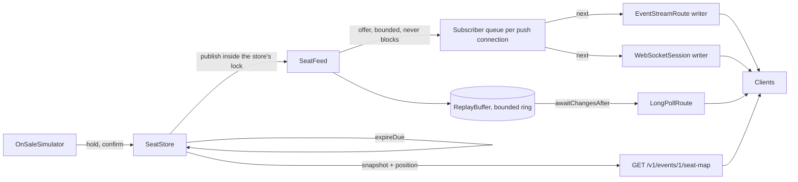

# Architecture of seatwave-live

The live seat-availability feed of Module 8 of *System Design Fundamentals*: one node that turns
every seat change into a numbered event and delivers it three ways, and the tools that measure the
three ways against each other.

## Packages

| Package | What it holds | Depends on |
|---|---|---|
| `io.plainround.seatwave.live` | `LiveFeedNode` (wires one node), `ServeCli` | every package below |
| `config` | `SettingsReader` (no defaults, every problem in one run), `LiveSettings` | `feed` (for `SeatLayout`) |
| `feed` | The domain: `SeatStore`, `SeatFeed`, `ReplayBuffer`, `Subscriber`, `Catchup`, `Delivery`, `FeedPosition`, `SeatChange`, `SeatMapSnapshot`, `SeatLayout`, `SeatState`, `OnSaleSimulator`, `ConnectionLimit`, `FeedMetrics` | nothing in the project |
| `wire` | JSON views and `FeedJson` (Jackson, known records only, unknown fields refused) | `feed` |
| `http` | `FeedHttpServer` on the JDK's HTTP server: `LongPollRoute`, `EventStreamRoute`, the seat map, the page, health, metrics, admin; `Replies` and problem details | `feed`, `wire`, `config` |
| `websocket` | The server side of RFC 6455 on the JDK's sockets: `Handshake`, `FrameCodec`, `WebSocketSession`, `WebSocketServer` | `feed`, `wire`, `http` (for `Parts`), `config` |
| `client` | The Java clients of the three methods (`LongPollConnection`, `EventStreamConnection`, `WebSocketConnection`) behind `FeedConnection`, and `FeedClient`, `ClientSeatMap`, `Backoff`, `ClientFleet` | `feed`, `wire` |
| `bench` | The measuring tools: `Comparison`, `ComparisonReport`, `WireBytesProbe`, `ByteCountingRelay`, `SlowConsumer`, `PollingRates`, `SseResume`, and their `*Cli` classes | every package |

**The dependency rule.** `feed` depends on nothing in the project and on no transport type: it
knows changes, positions and queues, never HTTP, sockets or JSON. The adapters (`http`,
`websocket`) translate between bytes and `feed` values at the edge. Only `*Cli` classes print or
exit.

## Data flow

## Walk-throughs

**A seat change.** `SeatStore.hold` takes the store's lock, checks Module 1's rule (only an
available seat can be held), sets the state and calls `SeatFeed.publish` before it lets go. The
feed takes its own lock (the order is always store, then feed), numbers the change one past the
last, appends it to the ring and offers it to every subscriber's bounded queue, then wakes every
held long poll. Each push connection's writer thread takes a batch from its queue, writes it
(events or frames) and flushes once. A held long poll wakes, reads the changes after its position
from the ring and replies.

**A reconnect.** A client that lost its connection backs off (a random wait under a doubling
ceiling, capped) and connects again with the position of the last change it applied, in `after=`
or, for an event stream, in `Last-Event-ID`. `SeatFeed.subscribe` reads the catch-up from the ring
and registers the subscriber in the same lock, so the client receives every later change exactly
once. If the ring no longer reaches back to its position, or the position belongs to another
stream identifier (an earlier process), the subscriber is marked for reload: the client gets a
`reload` message, loads the seat map, and starts again from the map's position.

**A slow consumer.** The publisher only offers to a subscriber's queue; it never writes to a
socket, so a client that stops reading cannot stop it. When that client's queue is full, the
subscriber drops its queued changes and marks itself for reload (memory per slow client stays at
the queue's bound). Its writer, stuck in a socket write, is found by the stuck-writer check that
`LiveFeedNode` runs four times per write timeout, and interrupted, which closes the socket.

## Decisions and trade-offs

- **The WebSocket server is written on the JDK, against RFC 6455.** The JDK has a WebSocket client
  (`java.net.http.WebSocket`) but no server, and its HTTP server cannot hand a connection over
  after `101 Switching Protocols`. The project writes the handshake, the framing and the close and
  heartbeat rules itself (eight files, about 840 lines with their comments), because the module teaches exactly those
  things and because the per-connection bounds must be the feed's own. Rejected:
  `org.java-websocket:Java-WebSocket` 1.6.0 (MIT, OSV lists nothing on 11 November 2026, but its
  last release was on 15 December 2024 and its per-connection send queue has no bound) and Jetty
  12.1.15's WebSocket server (EPL-2.0 or Apache-2.0, OSV lists nothing, released 9 November 2026,
  the production choice, but it brings its own HTTP server, so long polling and server-sent events
  would leave the JDK's server or the project would run two). In production, use a maintained
  server such as Jetty's.
- **The WebSocket feed has its own port** (8091 next to 8090), because the JDK's HTTP server cannot
  upgrade. A load balancer or reverse proxy (Modules 9 and 10) would put both behind one origin.
- **The seat store is in memory.** It keeps the module about delivery. Its rules are Module 1's,
  enforced under one lock; in production the database's conditional `UPDATE` keeps them and an
  outbox or change stream feeds the publisher (Module 27).
- **One lock for the publisher.** Numbering, appending and offering happen under it, so the order
  of the feed is the order of the store. Offers are bounded and non-blocking, so the lock is held
  for microseconds. At much higher rates a single publisher thread per event, fed by a queue, would
  replace the lock.
- **Positions carry a stream identifier.** The buffer lives in memory, so a restarted node starts
  numbering again; the random identifier makes an old position name another stream, which the
  feed answers with reload, never with someone else's history.
- **Slow-consumer policy: drop to reload, then disconnect.** For a seat map the current state is
  what matters; a client far behind needs one reload, not its backlog.
- **One JSON shape for all three methods,** encoded per write. Encoding once per change and reusing
  the bytes for every connection would save CPU at high fan-out; measured cost at 1,000 clients did
  not need it.

## Invariants and where they are enforced

| Invariant | Enforced in | Tested by |
|---|---|---|
| Changes are numbered without gaps, in the store's order | `SeatFeed.publish` under the feed's lock, called from inside the store's lock; `ReplayBuffer.append` refuses a hole | `ReplayBufferTest`, `SeatStoreTest` |
| A client that names its position gets every later change exactly once, or is told to reload; never a silent gap | `ReplayBuffer.after` (no third answer), `SeatFeed.subscribe` (catch-up and registration under one lock), `ClientSeatMap.apply` (counts a gap and forces a reload) | `SeatFeedTest`, `ReconnectCorrectnessTest`, `EventStreamRouteTest`, `MeasuringToolsTest` |
| A seat has at most one holder; an expired hold cannot be confirmed | `SeatStore` under its lock | `SeatStoreTest` |
| A slow client's memory is bounded | `Subscriber.offer` (capacity, then reload), the stuck-writer check | `SeatFeedTest`, `MeasuringToolsTest` |
| Open connections are bounded | `ConnectionLimit.admit` before any subscription | `ConnectionLimitTest`, `FeedHttpServerTest`, `WebSocketServerTest` |
| Only the allowed origin opens a WebSocket; client frames are masked | `Handshake.read`, `FrameCodec.read` | `HandshakeTest`, `FrameCodecTest`, `WebSocketServerTest` |
